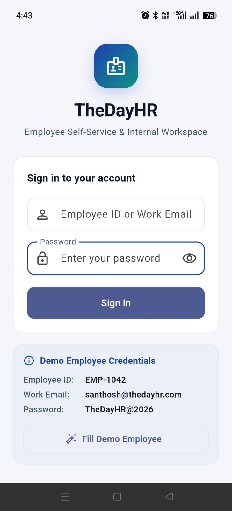
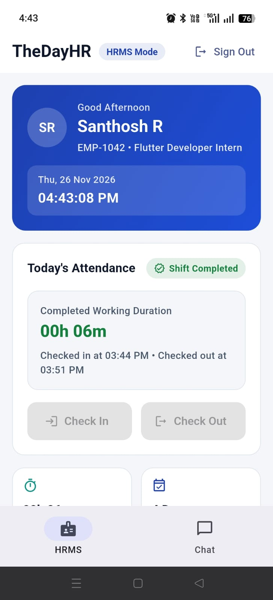
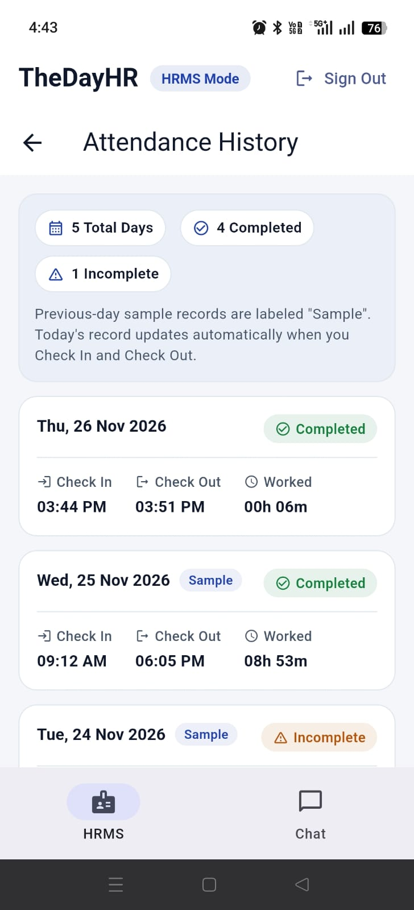
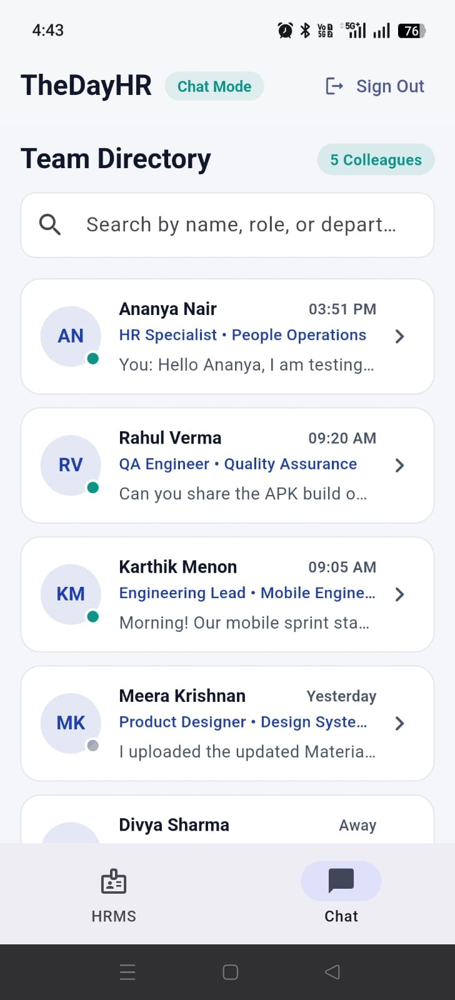
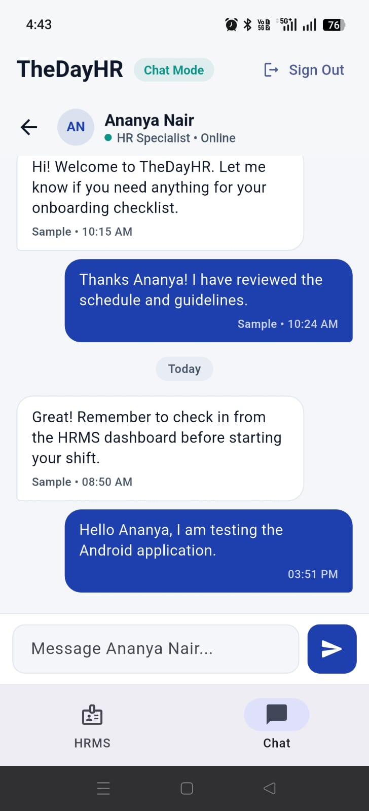

# TheDayHR - Employee Self-Service & Internal Workspace

A Flutter employee application built for the **TheDayHR Flutter Developer Intern Technical Assessment**. It combines an **HRMS Attendance** workspace and an **Internal Employee Chat** workspace inside a single adaptive Material 3 application with independent module states and local persistence.

> **Scope & Data Notice:** This application runs entirely offline using local/mock data and `SharedPreferences` persistence. There is **no backend server**, **no real-time messaging**, and **no multi-device synchronization**. Demo credentials are verified locally in memory for evaluation purposes only and do **not** represent production authentication or security.

---

## 1. Project Overview & Objectives

**TheDayHR** enables an authenticated employee to manage daily attendance (check-in, check-out, live working-hours tracking, and attendance history) alongside internal coworker messaging—while seamlessly switching between **HRMS Mode** and **Chat Mode** without losing active screens, timers, or unsent message drafts.

**Core Objectives:**
- Clean, maintainable **feature-first architecture** with repository abstractions.
- Predictable state management using **Riverpod** (`Notifier` / `NotifierProvider`).
- Per-employee local data persistence with malformed-data recovery.
- Responsive Material 3 UI supporting both narrow mobile screens (`NavigationBar`) and wider layouts (`NavigationRail`).
- Automated unit and widget test coverage across business rules, persistence, and mode switching.

---

## 2. Main Features

- **Employee Login & Validation:** Form validation for Employee ID/email and password, password visibility toggle, **Fill Demo Employee** helper, persistent session restoration, and sign-out.
- **HRMS Dashboard & Attendance:** Employee welcome card, live date and ticking clock, Check-In/Check-Out workflow, live elapsed timer, working-hours calculation, duplicate-action prevention, and summary metrics.
- **Attendance History:** Dedicated newest-first log of daily attendance records with completed, active, and incomplete shift statuses plus clearly marked previous-day `Sample` records.
- **Internal Chat Directory & Conversations:** Searchable coworker directory with avatar initials, availability indicators, latest message previews, one-to-one chronological threads, date separators, empty-message prevention, and draft preservation.
- **Independent Mode Switching:** Seamless switching between **HRMS Mode** and **Chat Mode** using `IndexedStack` and separate nested `Navigator` branches so neither module resets or loses state.

---

## 3. HRMS Module Functionality

- **Employee Welcome Header:** Displays time-of-day greeting, full name, Employee ID, designation, current date (`EEE, dd MMM yyyy`), and live clock (`hh:mm:ss a`).
- **Check-In & Check-Out Rules:**
  - Records local `DateTime` timestamps for today (`yyyy-MM-dd`).
  - **Enforces one valid attendance record per employee per day.**
  - **Prevents duplicate Check-In** while checked in or after today's shift is completed.
  - **Prevents Check-Out before Check-In** and **prevents duplicate Check-Out**.
- **Working-Hours Calculation:**
  - While checked in: shows a live elapsed timer (`HH:MM:SS`) and check-in time.
  - After check-out: calculates and displays total completed duration (`HHh MMm`).
- **Summary Metrics:** Shows Today's Hours, Completed Shifts, Average Shift Length, and Total Logged Hours.
- **Attendance History:** Lists all records sorted **newest date first**. On first launch, seeds 4 clearly labeled `Sample` records strictly for previous days (including one `Incomplete` record without a check-out time), never seeding a fake record for today.

---

## 4. Internal Chat Functionality

- **Team Directory (`ChatContactsScreen`):**
  - Displays mock coworkers with avatar initials, online/away status indicator, role, department, latest message preview (`You: ...` or received text), and formatted timestamp.
  - Real-time local search filtering by name, role, or department with a clear button, ordering active conversations by most recent message.
- **One-to-One Conversations (`ChatConversationScreen`):**
  - Displays coworker header with name, role, and availability status.
  - Renders received messages on the left and sent messages on the right with timestamps and day separators (`Today`, `Yesterday`, or date).
  - Enforces **chronological message ordering** (oldest to newest).
  - Seeds clearly labeled `Sample` received and sent messages on first launch.
  - Supports sending multiple messages, rejects empty/whitespace-only messages, auto-scrolls to the latest message, handles keyboard insets cleanly, and preserves unsent draft text per contact.

---

## 5. Application Mode Switching

- **Top-Level Modes:** `AppMode.hrms` (**HRMS Mode**) and `AppMode.chat` (**Chat Mode**), managed independently by `appModeProvider`.
- **Adaptive Navigation Shell (`AppShellScreen`):**
  - Width `< 720px`: bottom `NavigationBar`.
  - Width `>= 720px`: side `NavigationRail`.
  - Top `AppBar` displays the active mode badge (`HRMS Mode` / `Chat Mode`) and a working **Sign Out** button.
- **Zero-Loss State Preservation:**
  - `IndexedStack` keeps both `HrmsDashboardScreen` and `ChatContactsScreen` navigation trees alive in memory.
  - Switching modes preserves checked-in status, live working timer, open `AttendanceHistoryScreen`, open `ChatConversationScreen`, scroll positions, and unsent chat drafts.
  - Signing out clears the auth session and resets the shell back to `AppMode.hrms` for the next login.

---

## 6. Technology Stack

| Layer | Choice |
| :--- | :--- |
| **Framework & Language** | Flutter `3.41.6` (stable), Dart `3.11.4` |
| **UI Design System** | Material 3 (`useMaterial3: true`), built-in Flutter animations |
| **State Management** | `flutter_riverpod` (`^3.3.2`) — `Notifier` & `NotifierProvider` |
| **Local Persistence** | `shared_preferences` (`^2.5.6`) with JSON serialization |
| **Date & Time Formatting** | `intl` (`^0.20.3`) |
| **Navigation** | Standard Flutter `Navigator` + `IndexedStack` |
| **Linting & Testing** | `flutter_lints` (`^6.0.0`), `flutter_test` |

---

## 7. Project Architecture & Folder Structure

The project follows a **feature-first architecture** with repository abstractions separating storage details from Riverpod state notifiers and UI widgets:

```text
lib/
├── main.dart                                      # Initializes SharedPreferences & ProviderScope
├── app.dart                                       # Root MaterialApp, AppTheme & auth gate
├── core/
│   ├── constants/
│   │   └── storage_keys.dart                      # Per-employee & session storage key builders
│   ├── services/
│   │   └── local_storage_service.dart             # Safe SharedPreferences JSON wrapper
│   ├── theme/
│   │   └── app_theme.dart                         # Material 3 color tokens, cards, inputs & buttons
│   └── utils/
│       └── date_time_formatter.dart               # intl date, clock, duration & chat time helpers
└── features/
    ├── auth/
    │   ├── domain/
    │   │   ├── employee_user.dart                 # Authenticated employee model (no password field)
    │   │   └── auth_repository.dart               # Auth contract + LocalAuthRepository
    │   └── presentation/
    │       ├── providers/auth_provider.dart       # Login, logout & session restoration notifier
    │       ├── screens/login_screen.dart          # Login form, validation & demo credentials card
    │       └── widgets/auth_brand_header.dart     # Branded header
    ├── shell/
    │   └── presentation/
    │       ├── providers/mode_provider.dart       # Independent HRMS / Chat mode notifier
    │       └── screens/app_shell_screen.dart      # Adaptive shell + IndexedStack branch navigators
    ├── hrms/
    │   ├── domain/
    │   │   ├── attendance_record.dart             # Attendance record model & duration calculations
    │   │   └── attendance_repository.dart         # Attendance contract + LocalAttendanceRepository
    │   └── presentation/
    │       ├── providers/
    │       │   ├── clock_provider.dart            # 1-second DateTime stream & overridable clock
    │       │   └── hrms_provider.dart             # Attendance actions & duplicate-guard notifier
    │       ├── screens/
    │       │   ├── hrms_dashboard_screen.dart     # Employee dashboard, live clock & summary grid
    │       │   └── attendance_history_screen.dart # Full newest-first attendance history screen
    │       └── widgets/
    │           ├── attendance_action_card.dart    # Check-In / Check-Out controls & elapsed timer
    │           └── attendance_tile.dart           # Reusable attendance history row card
    └── chat/
        ├── domain/
        │   ├── chat_contact.dart                  # Employee directory contact model
        │   ├── chat_message.dart                  # Chat message model
        │   └── chat_repository.dart               # Chat contract + LocalChatRepository
        └── presentation/
            ├── providers/chat_provider.dart       # Search, drafts, send & chronological ordering
            ├── screens/
            │   ├── chat_contacts_screen.dart      # Searchable team directory
            │   └── chat_conversation_screen.dart  # Individual chat thread & keyboard-aware input
            └── widgets/
                ├── contact_tile.dart              # Contact row with status dot & latest preview
                └── message_bubble.dart            # Left/right aligned message bubble
```

---

## 8. Local Storage Explanation

All data is stored locally via `LocalStorageService` wrapping `SharedPreferences`:

| Storage Key | Stored Data | Notes |
| :--- | :--- | :--- |
| `thedayhr_auth_session_v1` | Current `EmployeeUser` JSON | Stores only profile metadata (`employeeId`, `name`, `email`, `department`, `designation`). **Passwords are never stored.** |
| `thedayhr_attendance_<EMPLOYEE_ID>_v1` | List of `AttendanceRecord` JSON | Scoped per employee ID so switching demo employees isolates attendance logs. |
| `thedayhr_chat_<EMPLOYEE_ID>_v1` | List of `ChatMessage` JSON | Scoped per employee ID so each employee maintains separate chat history. |

**Malformed Data & Error Handling:**
- `LocalStorageService` wraps reads, writes, and `jsonDecode`/`jsonEncode` calls in `try/catch` blocks so storage failures or corrupted JSON return `null` safely without crashing.
- `EmployeeUser.tryFromJson`, `AttendanceRecord.tryFromJson`, `ChatContact.tryFromJson`, and `ChatMessage.tryFromJson` validate field types and skip or clear malformed payloads.

---

## 9. Demo Employee Credentials

The login screen displays the primary demo credentials and includes a **Fill Demo Employee** button for quick testing. Two local demo accounts are supported for verifying per-employee storage isolation:

| Account | Employee ID | Work Email | Password | Role |
| :--- | :--- | :--- | :--- | :--- |
| **Primary Demo** | `EMP-1042` | `santhosh@thedayhr.com` | `TheDayHR@2026` | Flutter Developer Intern |
| **Secondary Demo** | `EMP-1088` | `ananya@thedayhr.com` | `TheDayHR@2026` | HR Specialist |

*(Reminder: These credentials are hardcoded local evaluation accounts only—not a production authentication system.)*

---

## 10. Flutter Dependency Installation

Ensure Flutter SDK (`3.41.x` or compatible) and Dart are installed, then install project packages:

```bash
flutter pub get
```

---

## 11. How to Run the Application

1. Check available devices:
   ```bash
   flutter devices
   ```
2. Run on a connected Android device/emulator:
   ```bash
   flutter run
   ```
3. Or run in Google Chrome for web preview:
   ```bash
   flutter run -d chrome
   ```

---

## 12. Android APK Build Instructions & Output Location

Build the signed-with-debug-key release APK (using standard Flutter + Android SDK command-line tools):

```bash
flutter build apk --release
```

**Verified Build Output:**
- **File path:** `build/app/outputs/flutter-apk/app-release.apk`
- **Package ID:** `com.santhosh.thedayhr_employee_app`
- **Verified APK size:** `48,907,508` bytes (`46.64 MB`)

---

## 13. Testing Instructions & Actual Test Results

Run static analysis and the full automated test suite:

```bash
flutter analyze
flutter test
```

**Verified Automated Results:**
- **`flutter analyze`:** Passed (`No issues found!`)
- **`flutter test`:** Passed (`+29: All tests passed!`)
  - `test/core/local_storage_service_test.dart` (5 tests): per-employee storage keys, JSON read/write, malformed JSON recovery, `DateTimeFormatter`.
  - `test/features/auth/auth_repository_test.dart` (5 tests): Employee ID/email login, password non-persistence check, invalid credential handling, corrupt session cleanup, logout.
  - `test/features/hrms/hrms_provider_test.dart` (7 tests): previous-day sample seeding (no today record), check-in/out rules, duplicate action prevention, working-hours calculation, per-employee persistence across reload, mode-switch state preservation.
  - `test/features/chat/chat_provider_test.dart` (8 tests): contact directory & sample messages, search filtering, empty-message prevention, chronological sorting, preview updates, per-employee isolation, draft & state preservation across mode switches.
  - `test/widget_test.dart` (4 widget tests): login validation, login-to-dashboard & sign-out flow, full end-to-end HRMS + Chat + mode-switch flow, and responsive layout verification at `320x568` and `1280x800` with zero overflow exceptions.

**Manual Verification (Chrome Web Preview):**
- **Google Chrome (`flutter run -d chrome`):** Manually inspected employee login, form validation, HRMS dashboard, live clock, check-in/out controls, attendance history, chat contact directory, one-to-one conversations, and HRMS/Chat mode switching.

**Manual Verification (Physical Android Smartphone):**
- **Manual APK Installation (without ADB):** Installed `build/app/outputs/flutter-apk/app-release.apk` manually on an Android smartphone and verified on-device:
  1. Employee login
  2. HRMS dashboard
  3. Attendance check-in and check-out
  4. Attendance history
  5. Chat directory and conversations
  6. Sending messages
  7. Switching between HRMS and Chat
  8. Closing the application and reopening it
  9. Login, attendance, and sent messages persisted after reopening the application

---

## 14. Screenshots

Actual screenshots captured from the release APK running on an Android smartphone:

| Screen | Screenshot |
| :--- | :--- |
| **Employee Login** |  |
| **HRMS Dashboard** |  |
| **Attendance History** |  |
| **Chat Contact Directory** |  |
| **One-to-One Conversation** |  |

---

## 15. Assessment Submission Information

- **Project:** `thedayhr_employee_app`
- **Submission Deliverables:**
  - GitHub source code repository
  - Release Android APK (`build/app/outputs/flutter-apk/app-release.apk`)
  - Application screenshots
  - Demo walkthrough video
